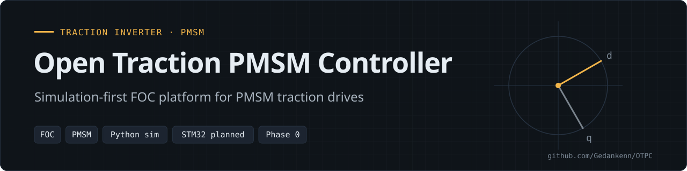

<p align="center"></p>

<p align="center">
  
  
  
  <a href="LICENSE"></a>
</p>

**OTPC (Open Traction PMSM Controller)** is an open-source Field-Oriented Control (FOC) platform for PMSM motors, designed to scale from low-power laboratory setups to electric-motorcycle traction drives.

> **Status: Phase 0, foundations.** Early-stage mathematical modeling and simulation. The repository currently contains the PMSM theory document and the Python motor model; firmware and power hardware are planned.

Related: [ESP32-FOC](https://github.com/Gedankenn/ESP32-FOC) · [3-phase-inverter](https://github.com/Gedankenn/3-phase-inverter) · [BLDC + EKF simulation](https://github.com/Gedankenn/Python-Simulation-of-BLDC-motor-using-Kalman-Filter)

---

## Overview

The goal is a **traction-grade motor controller** for an electric motorcycle, targeting an eventual **~400 cc equivalent** power level. The controller is meant to be:

- **Industrial in architecture**
- **Open-source in implementation**
- **Research-driven**, with full mathematical derivation and validation
- **Scalable**, starting from a low-power PMSM test motor

This is **not** a hobby ESC. It is a full **traction inverter + control system**, built step by step with correctness, safety and extensibility as primary goals.

### Design philosophy

- **Field-Oriented Control (FOC)** as the fundamental control strategy
- **Torque-controlled architecture**
- **dq-frame control** with proper reference-frame separation
- **Explicit modeling of electrical and mechanical dynamics**
- **Observer-based state estimation**
- **Hardware-aware control design**
- **Simulation first, hardware second.** No firmware is written without prior simulation; if it does not behave correctly in simulation, it is not deployed to hardware.

All design decisions are documented and justified.

### Scope

| Included | Not included |
|---|---|
| PMSM mathematical modeling | Mechanical vehicle design |
| Reference-frame transformations (abc → αβ → dq) | Battery pack design |
| Current control loops | BMS hardware (interface-level integration only) |
| Space Vector PWM (SVPWM) | |
| State observers (planned: EKF / Kalman-based) | |
| Simulation environment (Python) | |
| Embedded firmware (STM32) | |
| Safety-oriented control architecture | |

## Features

What is in the repository today:

| Part | State |
|---|---|
| `docs/theory.md`: PMSM model in abc/αβ/dq frames, Clarke/Park, dq electrical model, torque, mechanical dynamics | ✔ written |
| `simulation/motor_model.py`: `PMSMParameters` + `PMSM` class (dq electrical dynamics, torque, mechanical dynamics, `step()`) and `clarke` / `park` / `inv_park` helpers | ✔ code |
| `simulation/simulation.py`: trapezoidal speed-profile reference generation and plotting | ✔ code |
| `simulation/control.py`, `simulation/svpwm.py` | placeholder (empty) |
| `docs/control.md`, `docs/observers.md` | placeholder (empty) |

## Hardware

Target hardware is **planned**; none is in the repository yet.

| Block | Plan |
|---|---|
| **Control MCU** | STM32 family (motor-control variants): hardware PWM timers, synchronized ADC sampling, deterministic real-time execution |
| **Power stage** (future phases) | 3-phase inverter; DC bus 72–96 V for development, scalable upward; phase current scalable to traction levels; isolated gate drivers; hardware protection |

## Architecture

```text
.
├── docs/
│   ├── theory.md        # PMSM mathematical model: abc/αβ/dq frames, Clarke/Park, dq electrical model, torque, mechanical dynamics
│   ├── control.md       # (placeholder, empty)
│   └── observers.md     # (placeholder, empty)
│
├── simulation/
│   ├── motor_model.py   # PMSMParameters + PMSM class (dq electrical dynamics, torque, mechanical dynamics, step()) and clarke/park/inv_park helpers
│   ├── simulation.py    # Reference-signal (trapezoidal speed profile) generation and plotting
│   ├── control.py       # (placeholder, empty)
│   └── svpwm.py         # (placeholder, empty)
│
├── LICENSE
└── README.md
```

Planned (not yet in the repository): STM32 firmware (`firmware/`) and power-stage hardware (`hardware/`).

### Simulation approach

The simulation environment is intended to:

- use fixed-step integration
- mimic real-time control execution
- include saturation, limits and delays
- be structured to map directly to embedded code

### Documentation approach

All mathematical models, assumptions and control decisions are documented as Markdown papers under `docs/`, written as a thesis-style technical record: model assumptions, reference-frame choices, control-loop design rationale, discretization and timing, observer structure, and practical implementation constraints. The goal is full transparency and reproducibility.

## Build & Run

The simulation scripts use Python 3 with `numpy`, `matplotlib` and `mplcyberpunk` (there is no requirements file yet):

```bash
pip install numpy matplotlib mplcyberpunk
python3 simulation/simulation.py   # plots the reference signal
```

## Usage

`simulation/motor_model.py` provides the `PMSM` model class to be imported by the control-loop simulation.

## Roadmap

**Phase 0: Foundations (current)**
- [ ] Mathematical derivation
- [ ] Control architecture definition
- [ ] Python-based simulation
- [ ] Low-power PMSM testing (bench motor)

**Phase 1: Embedded control core**
- [ ] FOC implementation on STM32
- [ ] Current sensing and timing validation
- [ ] SVPWM implementation
- [ ] Stable closed-loop current control

**Phase 2: Estimation & dynamics**
- [ ] Speed and position estimation
- [ ] Observer design and tuning
- [ ] Transition from sensored to sensorless operation

**Phase 3: Traction features**
- [ ] Torque request interface
- [ ] Regenerative braking
- [ ] Field weakening
- [ ] CAN communication (vehicle integration)

**Phase 4: High-power scaling**
- [ ] Traction inverter hardware
- [ ] Thermal considerations
- [ ] Safety validation
- [ ] Vehicle-level testing

**Long-term goal:** a fully open, industrial-quality traction motor controller that is technically rigorous, practically usable, able to power a real electric motorcycle, and a reference-quality learning and research platform.

> "This project is not about making a motor spin. It is about understanding and controlling energy, torque, and motion — correctly."

## Safety disclaimer

> [!WARNING]
> This project involves high-power electrical systems. Improper implementation can cause equipment damage, fire, severe injury or death.
> This repository is provided for educational and research purposes only. The author assumes no responsibility for misuse or unsafe implementations.

## License

Released under the MIT License. See [LICENSE](LICENSE).

---
<sub>Part of <a href="https://github.com/Gedankenn">Fabio Slika Stella's</a> embedded work · <a href="https://gedankenn.github.io/Gedankenn/">portfolio</a></sub>
